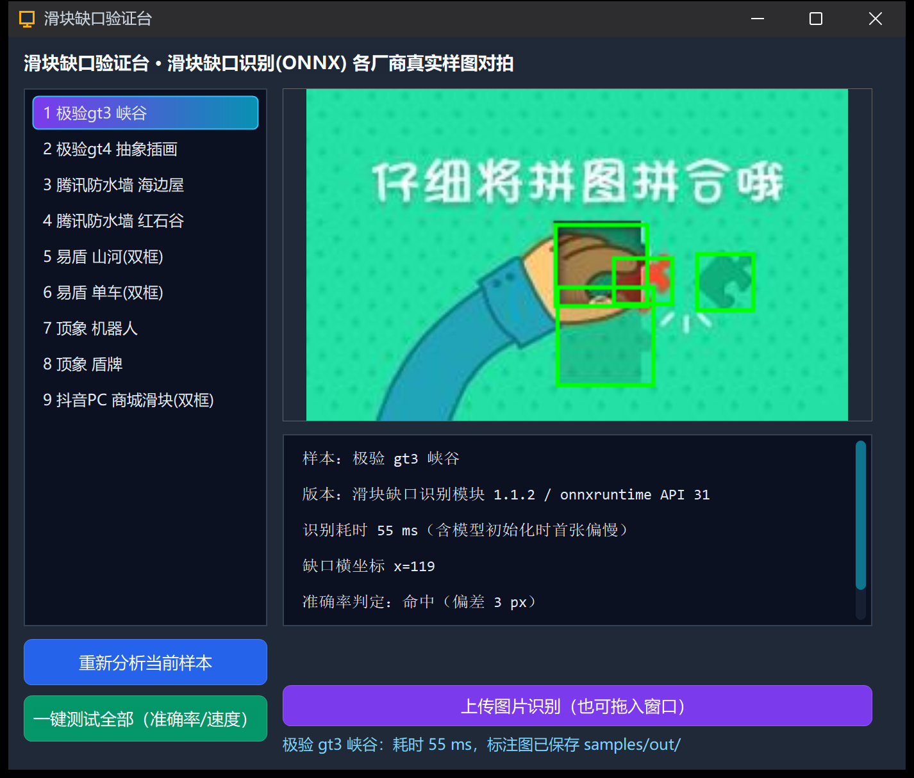

# GapBench · 滑块缺口验证台

**离线本地推理的滑块验证码缺口定位工具 · 基于 LingBuilder 中文编程 + YOLOv8 ONNX**

[简体中文](#中文说明) | [English](#english)

---

## 中文说明

**滑块缺口验证台（GapBench）** 是一款开源的 Windows 桌面工具，用于检测滑块验证码背景图中的缺口位置。基于 YOLOv8 + ONNX Runtime 的本地 CPU 推理，毫秒级出结果，**全程离线、不上传任何图片**。

### 它能做什么

- **一键基准测试**：内置极验（gt3/gt4）、腾讯防水墙、网易易盾、顶象、抖音 PC 等主流厂商真实滑块样图 9 张，点一下按钮即输出整体命中率（±10px 判定）与每张耗时（毫秒）。实测 **9/9 命中，平均约 58ms/张**。
- **可视化对拍**：识别结果实时画成绿框标注图，候选框坐标、宽高、置信度逐行列出，一眼核对检出位置。
- **上传 / 拖入识别**：点按钮选择图片，或直接把图片拖进窗口，即可识别任意滑块截图；一次可拖多张。
- **双框语义提示**：易盾 / 抖音类背景图同时包含「滑块起点」与「缺口」两个拼图块，程序会给出取框口径说明（拖动距离 = 缺口x − 起点x）。

### 这是本地还是云端？

**识别 100% 本地。** 模型（`slider.onnx`，YOLOv8）与推理运行库（ONNX Runtime）随构建直接编进产物，识别过程不联网、不上传任何数据。9 张内置样图也以**内嵌资源**形式打进 EXE，启动时自动释放到程序目录。

### 如何编译

1. 安装开源版 LingBuilder IDE：**https://github.com/mosheng20205/lingbuilder**（需自备 Visual Studio 的 MSVC x64 工具链）。
2. 在 IDE 模块管理中免费安装两个模块：
   - **滑块缺口识别模块**（`lingbuilder.captcha.gap` 1.1.2+，含识别模型与 onnxruntime，约 39MB）
   - **内嵌资源模块**、**日期时间模块**、**Win32 高级控件模块**、**文件目录模块**（内置模块，如未启用请一并启用）
3. 用 IDE 打开源码包（导入 `GapBench.lcpppkg`）或直接打开 `workspace\滑块缺口验证台.lbsln`，按 **F5** 编译运行。
4. 9 张样图以内嵌资源形式随 EXE 分发，启动时自动释放到程序目录的 `samples\` 下，无需任何手工拷贝。

### 源码包说明

本仓库的开源内容是一个 `.lcpppkg` 源码分享包（LingBuilder 标准工程分享格式），内含全部中文源码、窗口设计器模型、内嵌资源清单与项目配置。许可证见 [LICENSE](LICENSE)（MIT）与 [docs/第三方许可.md](docs/第三方许可.md)（识别模型与 onnxruntime 等第三方组件许可）。

### 合规声明

本工具只做**图像内容分析**（定位缺口拼图块），不包含浏览器控制、验证提交、轨迹伪造等任何对抗风控的行为逻辑。对目标网站进行自动化前，请确认你拥有相应授权并遵守其服务条款与当地法律法规。

---

## English

**GapBench** is an open-source Windows desktop tool that locates slider-CAPTCHA gaps in images. Powered by a YOLOv8 model running fully offline via ONNX Runtime on CPU, it reports bounding boxes, confidence scores and per-image latency in milliseconds — **no cloud, no uploads**.

### Highlights

- **One-click benchmark** — 9 real-world slider samples from GeeTest (gt3/gt4), Tencent CAPTCHA, NetEase Yidun, DingXiang and Douyin PC are built in; a single click reports overall hit rate (±10px) and per-image latency. Measured **9/9 hits at ~58ms/image**.
- **Visual inspection** — detections are drawn as green boxes onto the image; every candidate's coordinates, size and confidence are listed.
- **Upload & drag-and-drop** — pick a file or drop images onto the window to analyze your own screenshots, multiple files at once.
- **Dual-box semantics** — Yidun/Douyin backgrounds contain both the slider start and the gap; the UI explains the take-distance convention (gap x − start x).

### Build

1. Install the open-source LingBuilder IDE: **https://github.com/mosheng20205/lingbuilder** (MSVC x64 toolchain required).
2. Install the free modules in the IDE module manager: **滑块缺口识别模块 / Slider Gap Recognition Module** (`lingbuilder.captcha.gap` 1.1.2+, bundles the ONNX model and onnxruntime, ~39MB) plus the built-in modules listed in the project manifest.
3. Open `GapBench.lcpppkg` (or `workspace\滑块缺口验证台.lbsln`) and press **F5**. The 9 sample images are embedded into the EXE and auto-extracted at startup.

### License

MIT — see [LICENSE](LICENSE). Third-party notices (recognition model, onnxruntime, stb): [docs/第三方许可.md](docs/第三方许可.md).

### Disclaimer

This tool performs **image content analysis only** (locating puzzle-piece gaps). It contains no browser automation, no CAPTCHA submission and no anti-bot evasion logic. You are responsible for complying with the terms of service of any website you automate and with applicable laws.
